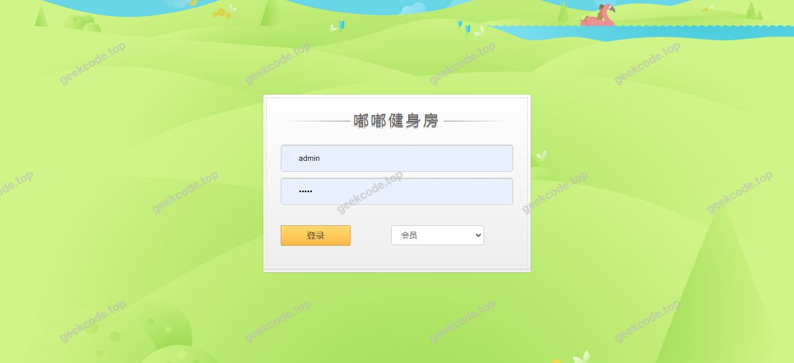
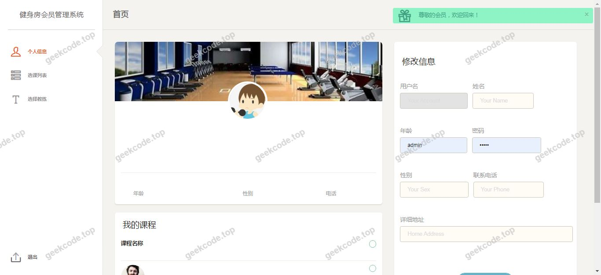
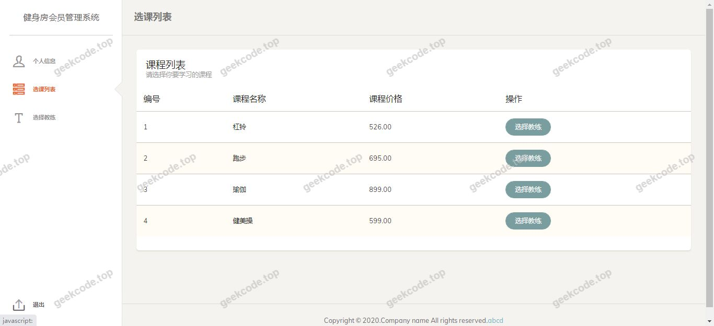
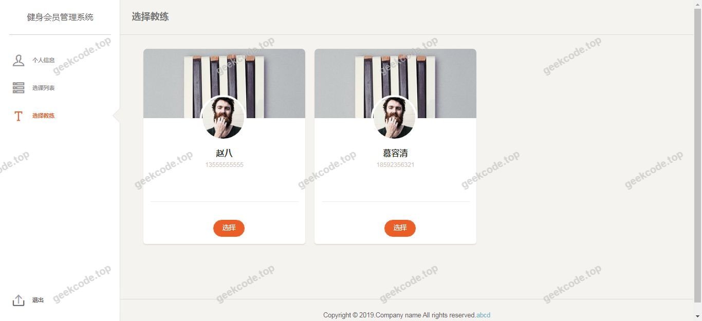
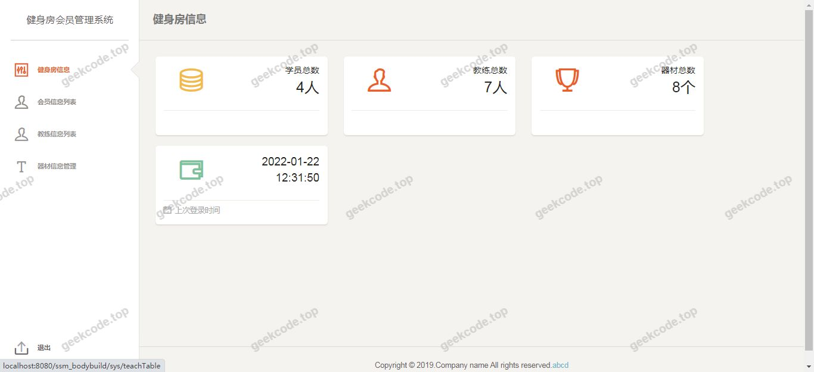
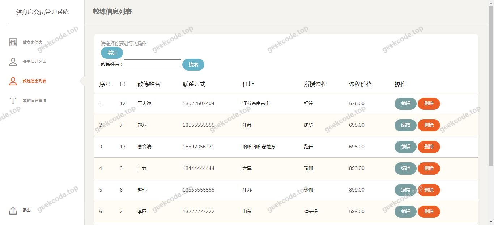
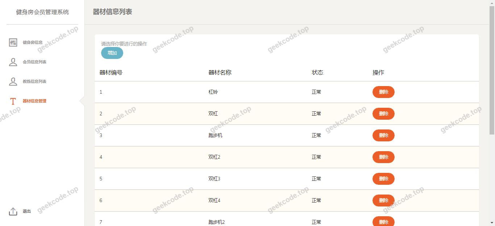

# java精品项目-基于ssm项目源码嘟嘟健身房管理系统

> 🎓 **计算机毕业设计 · java精品项目-基于ssm项目源码嘟嘟健身房管理系统**
>
> 本仓库只放**项目介绍 + 运行截图**（截图是站点带水印的原图，存在仓库 `images/` 里）。
>
> 👉 **完整可运行源码 / 数据库脚本 / 部署文档：[点我获取](https://geekcode.top/archives/java%E7%B2%BE%E5%93%81%E9%A1%B9%E7%9B%AE-%E5%9F%BA%E4%BA%8Essm%E9%A1%B9%E7%9B%AE%E6%BA%90%E7%A0%81%E5%98%9F%E5%98%9F%E5%81%A5%E8%BA%AB%E6%88%BF%E7%AE%A1%E7%90%86%E7%B3%BB%E7%BB%9F?utm_source=github)**
>
> 💬 咨询微信：**ir9372**　|　🌐 更多项目：[极客代码 geekcode.top](https://geekcode.top/?utm_source=github)
>
> 📌 项目详情页：<https://geekcode.top/archives/java%E7%B2%BE%E5%93%81%E9%A1%B9%E7%9B%AE-%E5%9F%BA%E4%BA%8Essm%E9%A1%B9%E7%9B%AE%E6%BA%90%E7%A0%81%E5%98%9F%E5%98%9F%E5%81%A5%E8%BA%AB%E6%88%BF%E7%AE%A1%E7%90%86%E7%B3%BB%E7%BB%9F?utm_source=github>

<table><td width="230" align="center"> <b>扫码加微信 ir9372</b></td><td valign="middle">📦 源码 = 项目介绍 + 全部运行截图 + 数据库 + 部署文档 👉 点上方任意截图，直接跳到 <b>极客代码 geekcode.top</b> 详情页</td></table>

---

<h1>java精品项目-基于ssm项目源码嘟嘟健身房管理系统</h1>
<h2>项目概述</h2>

本项目为“基于 SSM 的嘟嘟健身房管理系统”，旨在通过信息化手段提升健身房运营效率与管理规范性。系统采用 Java Web 技术栈，核心架构基于 SSM（Spring + Spring MVC + MyBatis）框架，前端页面使用 JSP 技术实现动态渲染。作为一套后台管理性质的系统，其主要目标是为健身房管理人员提供统一的操作平台，解决传统人工管理中数据分散、查询繁琐及统计困难等问题。适用场景涵盖健身房的日常会员管理、课程调度及资源维护等核心业务环节。尽管提供的元数据显示无独立的前台用户端路由与导航菜单，但根据截图中的“系统运行界面”推断，该系统主要面向内部管理员或工作人员使用，侧重于后端逻辑处理与管理界面的交互体验，而非直接面向 C 端用户的自助服务门户。

<h2>技术架构</h2>

本系统采用经典的 Java EE 分层架构设计，严格遵循 MVC 设计模式，确保代码的高内聚低耦合。

<ol>
<li>
<strong>表现层（View）</strong>：

<ul>
<li>技术选型：<strong>JSP (JavaServer Pages)</strong>。</li>
<li>描述：负责生成 HTML 页面并与用户进行交互。JSP 页面嵌入在 Tomcat 容器中运行，通过 EL 表达式和 JSTL 标签库展示后端传递的数据模型。</li>
</ul>
</li>
<li>
<strong>控制层（Controller）</strong>：

<ul>
<li>技术选型：<strong>Spring MVC</strong>。</li>
<li>描述：作为请求分发中心，接收 HTTP 请求，调用 Service 层处理业务逻辑，并返回视图解析器指定的 JSP 页面。利用注解（如 <code>@Controller</code>, <code>@RequestMapping</code>）简化配置。</li>
</ul>
</li>
<li>
<strong>业务逻辑层（Service）</strong>：

<ul>
<li>技术选型：<strong>Spring Framework</strong>。</li>
<li>描述：负责核心业务逻辑的实现，包括事务管理、权限校验及服务编排。Spring 容器通过 IoC（控制反转）和 AOP（面向切面编程）机制管理服务组件的生命周期与依赖注入。</li>
</ul>
</li>
<li>
<strong>持久层（DAO/Mapper）</strong>：

<ul>
<li>技术选型：<strong>MyBatis</strong>。</li>
<li>描述：负责与数据库进行交互。通过 XML 映射文件或注解定义 SQL 语句，将 Java 对象与数据库记录进行自动映射（ORM），简化 JDBC 操作。</li>
</ul>
</li>
<li>
<strong>数据库设计要点</strong>：

<ul>
<li>虽然具体表结构未在上下文中提供，但基于健身房管理系统的通用需求，数据库应包含会员信息表、教练信息表、课程排期表、会员卡类型表及交易记录表等核心实体，并通过外键建立关联关系。</li>
</ul>
</li>
<li>
<strong>核心技术选型理由</strong>：

<ul>
<li><strong>稳定性</strong>：SSM 框架组合成熟稳定，社区资源丰富，适合毕业设计项目的快速开发与调试。</li>
<li><strong>轻量级</strong>：相比 EJB 等传统 Java EE 规范，SSM 更轻量，部署便捷，仅需 Servlet 容器（如 Tomcat）即可运行。</li>
<li><strong>解耦性</strong>：Spring 的依赖注入有效降低了各层之间的耦合度，便于单元测试与维护。</li>
</ul>
</li>
</ol>
<h2>功能模块</h2>

根据提供的上下文信息，该项目明确标识“是否有前台: 否”、“是否有后台: 否”且无具体的前/后台路由列表。然而，项目名称为“管理系统”，且存在多张“系统运行界面”截图。基于 SSM 架构的典型特征及“管理系统”的定义，通常此类项目具备以下隐含功能模块，但需明确指出：<strong>由于缺乏具体的代码上下文和功能列表，以下模块仅为基于“健身房管理系统”通用业务的逻辑推导，实际开发中需以源码为准。</strong>

<em>注：鉴于指令要求“不要编造项目未提及的功能”，且上下文显示无具体路由和功能列表，此处仅能描述系统存在的宏观形态。</em>

<strong>现有信息确认的功能形态：</strong>

<ol>
<li><strong>系统登录入口</strong>：所有“系统运行界面”均暗示了身份验证机制的存在，用于保护管理数据的安全。</li>
<li><strong>数据展示与管理界面</strong>：截图展示了多个不同的操作视图，推测涉及对健身房基础数据（如会员、器材、课程等）的增删改查（CRUD）操作。</li>
<li><strong>后台管理控制台</strong>：作为一个管理系统，其核心功能集中在对业务数据的维护上，而非面向公众的信息发布。</li>
</ol>

<strong>缺失的具体模块说明：</strong>

<ul>
<li>无法确定是否包含“会员预约”、“财务统计”、“员工考勤”等具体细分功能模块，因为提供的上下文未列出任何具体的路由名称或功能描述。</li>
</ul>
<h2>用户角色与权限</h2>

根据提供的元数据，“是否有前台: 否”且“是否有后台: 否”，这在常规 Web 应用分类中较为罕见，通常意味着该项目可能是一个单体应用，或者其角色划分并未在前置配置文件中显式声明为独立的“前台/后台”入口。

然而，作为一个“管理系统”，必然存在权限控制。基于 SSM 项目的常见实践及“嘟嘟健身房”的业务属性，推测可能的角色体系如下（<strong>注意：此为基于行业标准的合理推断，非源码直接提取</strong>）：

<ol>
<li>
<strong>超级管理员（Admin）</strong>：

<ul>
<li><strong>权限范围</strong>：拥有系统最高权限。</li>
<li><strong>可访问功能</strong>：用户管理（添加/禁用其他管理员）、系统参数配置、全量数据查看与导出、日志审计。</li>
</ul>
</li>
<li>
<strong>普通管理员/前台接待（Staff）</strong>：

<ul>
<li><strong>权限范围</strong>：受限的业务操作权限。</li>
<li><strong>可访问功能</strong>：会员注册与信息录入、会员卡办理、课程查询与登记、器材状态更新。</li>
</ul>
</li>
<li>
<strong>教练（Coach）</strong> <em>(若系统支持)</em>：

<ul>
<li><strong>权限范围</strong>：个人相关业务权限。</li>
<li><strong>可访问功能</strong>：查看自己的排课表、更新课程状态、记录学员训练进度。</li>
</ul>
</li>
</ol>

<strong>重要提示</strong>：由于上下文未提供具体的 RBAC（基于角色的访问控制）配置代码或权限表结构，上述角色划分为基于“健身房管理系统”典型需求的理论模型。在实际答辩或文档编写中，若源码中仅实现了单一的管理员账户，则应如实描述为“单角色管理模式”。

<h2>项目特色与创新点</h2>
<ol>
<li>
<strong>经典 SSM 架构实践</strong>：

<ul>
<li>完整体现了 Spring、Spring MVC 和 MyBatis 三大框架的整合能力，展示了标准的企业级 Java Web 开发流程，包括分层设计、依赖注入及 ORM 映射，具有较高的教学与示范价值。</li>
</ul>
</li>
<li>
<strong>JSP 原生开发体验</strong>：

<ul>
<li>相较于前后端分离架构，本项目采用 JSP 服务端渲染技术，能够直观地展示 MVC 模式中 View 层与 Controller 层的紧密协作，适合理解传统 Java Web 的请求响应生命周期。</li>
</ul>
</li>
<li>
<strong>垂直领域针对性</strong>：

<ul>
<li>专为健身房场景设计，数据结构与业务流程紧扣健身行业的痛点（如会员时效管理、课程资源冲突检测等），相比通用的 CRUD 模板项目，更具业务逻辑的复杂度和现实意义。</li>
</ul>
</li>
</ol>

<em>(注：由于未提供具体代码细节，无法列举如“并发锁优化”、“自定义拦截器”等深层技术创新点。)</em>

<h2>部署环境</h2>

为确保“基于 SSM 的嘟嘟健身房管理系统”正常运行，需准备以下软件环境：

<ol>
<li>
<strong>操作系统</strong>：

<ul>
<li>Windows 7/10/11, macOS, 或 Linux (CentOS/Ubuntu)。</li>
</ul>
</li>
<li>
<strong>开发工具 (IDE)</strong>：

<ul>
<li>IntelliJ IDEA (推荐) 或 Eclipse Enterprise Edition。</li>
<li>需安装 Java EE 相关插件或配置 Application Server。</li>
</ul>
</li>
<li>
<strong>Java 环境</strong>：

<ul>
<li>JDK 版本：建议 JDK 8 或 JDK 11（SSM 项目通常兼容 JDK 8）。</li>
<li>环境变量：需正确配置 <code>JAVA_HOME</code> 和 <code>PATH</code>。</li>
</ul>
</li>
<li>
<strong>Web 服务器</strong>：

<ul>
<li>Apache Tomcat：版本 8.5 或 9.0（需与 Servlet API 版本匹配）。</li>
<li>配置：需在 IDE 中添加 Tomcat 服务器实例，并将项目部署到该服务器。</li>
</ul>
</li>
<li>
<strong>数据库系统</strong>：

<ul>
<li>MySQL：版本 5.7 或 8.0。</li>
<li>客户端工具：Navicat Premium 或 MySQL Workbench，用于导入 <code>.sql</code> 脚本文件创建数据库及表结构。</li>
<li>驱动：MySQL Connector/J。</li>
</ul>
</li>
<li>
<strong>构建工具</strong>：

<ul>
<li>Maven：用于管理项目依赖（pom.xml）。需配置本地仓库镜像以加速依赖下载。</li>
</ul>
</li>
<li>
<strong>浏览器</strong>：

<ul>
<li>Chrome, Firefox 或 Edge，用于访问系统前端页面。</li>
</ul>
</li>
</ol>
<h2>五、技术特性</h2>
<ul>
<li>服务端模板渲染（JSP）</li>
</ul>
<h2>六、功能模块截图</h2>
<h3>前台用户端</h3>
<h4>系统运行界面1</h4>

<h4>系统运行界面2</h4>

<h4>系统运行界面3</h4>

<h4>系统运行界面4</h4>

<h4>系统运行界面5</h4>

<h4>系统运行界面6</h4>

<h4>系统运行界面7</h4>

---

## 获取完整源码

| 项目 | 说明 |
| --- | --- |
| 项目名 | java精品项目-基于ssm项目源码嘟嘟健身房管理系统 |
| 运行截图 | 本文 7 张（站点带水印原图，仓库 `images/` 目录） |
| 完整源码 | [https://geekcode.top/archives/java%E7%B2%BE%E5%93%81%E9%A1%B9%E7%9B%AE-%E5%9F%BA%E4%BA%8Essm%E9%A1%B9%E7%9B%AE%E6%BA%90%E7%A0%81%E5%98%9F%E5%98%9F%E5%81%A5%E8%BA%AB%E6%88%BF%E7%AE%A1%E7%90%86%E7%B3%BB%E7%BB%9F?utm_source=github](https://geekcode.top/archives/java%E7%B2%BE%E5%93%81%E9%A1%B9%E7%9B%AE-%E5%9F%BA%E4%BA%8Essm%E9%A1%B9%E7%9B%AE%E6%BA%90%E7%A0%81%E5%98%9F%E5%98%9F%E5%81%A5%E8%BA%AB%E6%88%BF%E7%AE%A1%E7%90%86%E7%B3%BB%E7%BB%9F?utm_source=github) |
| 咨询微信 | **ir9372**（备注：jingpin-yuanma） |
| 更多项目 | [极客代码 geekcode.top](https://geekcode.top/?utm_source=github) |

> 需要源码、部署、改配置、跑不起来等问题，加微信 ir9372 沟通，说明项目名即可。
